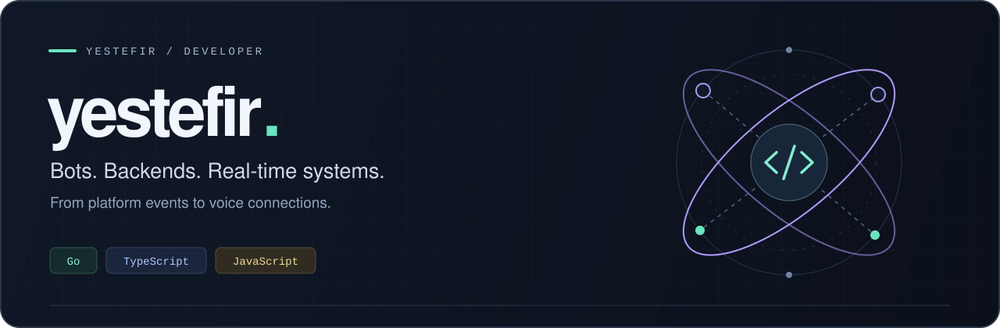

  

  <a href="https://github.com/yestefir/micup.go">Go client library</a> &nbsp; / &nbsp;
  <a href="https://github.com/yestefir/discord-bot-nest">NestJS bot</a> &nbsp; / &nbsp;
  <a href="https://github.com/yestefir/discord-bot">Discord toolkit</a>

### Building the parts behind the interaction.

I'm **yestefir**. I build bot infrastructure and platform integrations with **Go**, **TypeScript**, and **JavaScript** — from Gateway sessions and REST clients to voice connections and bot commands.

My focus: clear package boundaries, recoverable connections, and code that can grow beyond its first feature.

### Selected work

| Project | What I'm building | Stack |
| :--- | :--- | :--- |
| **[micup.go](https://github.com/yestefir/micup.go)** | A standalone Go client for Micup. Resumable Gateway sessions, multi-shard management, rate-aware REST, permission state, and LiveKit voice publishing. | `Go` · `WebSocket` · `LiveKit` |
| **[discord-bot-nest](https://github.com/yestefir/discord-bot-nest)** | A Discord bot built with NestJS and Necord, using TypeORM and PostgreSQL. | `TypeScript` · `NestJS` · `PostgreSQL` |
| **[discord-bot](https://github.com/yestefir/discord-bot)** | A customizable Discord.js v14 foundation with modular commands, event handlers, buttons, modals, and menus. | `JavaScript` · `Node.js` · `Discord.js` |

### Where I spend my time

- **Platform clients** — Gateway events, REST APIs, state caches, and rate limits.
- **Real-time connections** — session recovery, sharding, and voice transport.
- **Bot architecture** — reusable modules, command handling, and persistence.

 

  Explore the code. For project questions and bug reports, open an issue in the relevant repository.

